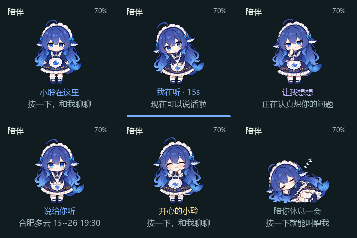
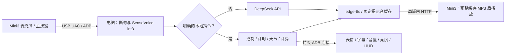

# 《我把开发板变成“大肥鱼”，它居然成为了我的贴心小管家！》

把一块 **Arcs-Mini3** 变成放在桌边的语音伙伴：能陪我聊天、练英语、讲故事，也能查询天气、计时提醒、调节音量和亮度。

我一开始只是想让开发板开口说话，后来给它换上“大肥鱼”的外观，把语音交互、表情和日常小工具连在一起。现在，按一下主功能键，它会抬起精神听我说话；一句“休息一下”，又会闭上眼睛安静陪着我。

<p align="center">
  
</p>

> 上图是电脑生成的界面预览，不是实机照片。角色素材来自 [YunYueSama/codex-deepseek-pet](https://github.com/YunYueSama/codex-deepseek-pet)，本项目进行了裁剪、缩放、RGB565 转换和设备交互适配，完整署名与许可随仓库保留。

## 它现在能做什么？

| 模块 | 可以怎么用 |
| --- | --- |
| 语音对话 | 短按主功能键，等“我在听”后说话；说完停顿约一秒自动断句 |
| 连续对话 | 切换成连续模式后，在聆听阶段直接说话；处理和播放时关闭采音 |
| 大肥鱼界面 | 眨眼、呼吸、入睡/醒来过渡，随聆听、思考、说话改变姿态 |
| 独立表情 | “换成开心表情”“恢复正常表情” |
| 英语陪练 | “切换到英语陪练”，用中英文练习交流 |
| 故事模式 | “切换到故事模式”，让它讲一个小故事 |
| 播放停止 | 回答播放时短按主键停止，随后接收新问题 |
| 屏幕与音量 | “屏幕亮度调到百分之五十”“小声一点” |
| 计时与提醒 | “计时二十秒”“暂停计时”“继续计时”“半小时后提醒我喝水” |
| 日常小工具 | 北京时间、日期、受限四则计算、常用单位换算 |
| 天气预报 | 查询今天、明天、后天的日预报；默认城市合肥，可语音更换 |
| 休息与唤起 | “休息一下”关闭电脑采音，按主键恢复交互 |
| 拍摄提示助手 | 按约 8～9 分钟的分镜，提示本人操作，并观察实际执行反馈 |

目前的使用方式是：**电脑保持运行，Mini3 通过 USB 采音和传递控制，通过同局域网 Wi-Fi 下载回答音频。** 本地语音识别运行在电脑 CPU 上；DeepSeek 对话与 edge-tts 合成需要联网。

## 从一句话到一次回应



这套实现中，明确的设备控制和本地工具请求不会交给对话模型猜执行结果；普通聊天只保留最近三轮上下文。持久 ADB 连接统一串行处理状态、按键和播放命令，另一个本项目进程无法抢占同一把连接锁。

## 快速开始

**目标设备仅为 Arcs-Mini3，构建板型为 `arcs_mini3`。** 建议使用 Windows、Python 3.12 和 PowerShell 7。

1. 按 [电脑端安装说明](docs/setup-windows.md) 准备 Python 环境、ADB 和两个识别模型。
2. 按 [固件接入说明](docs/firmware.md) 获取官方源码，并应用本仓库的稳定功能补丁。
3. 将 Mini3 接到电脑，并让两者连接可互通的同一局域网。
4. 在仓库根目录运行：

```powershell
.\mini3-agent\start.ps1 -Mode button
```

没有配置 DeepSeek 密钥时，前台程序会以隐藏输入方式询问。**不要把密钥写入源码、固件或提交记录。**

查看连接诊断、后台运行和拍摄入口的详细用法，见 [电脑端安装说明](docs/setup-windows.md)。

## 想拍一段完整演示？

双击 [开始拍摄.cmd](mini3-agent/开始拍摄.cmd)。提示助手会先检查连接，然后停在“准备录像”页。

- 你自己开始录像，按电脑回车推进提词。
- 按提示短按开发板主键、说指令、观察屏幕和声音。
- 它会观察真实识别、控制确认与播放事件，完成后提示下一项。
- `R` 重新提示本步，`S` 跳过，`F` 直接收尾，`Q` 退出；不会自动重发对话请求。

[完整拍摄提词稿](mini3-agent/拍摄提词稿.md)覆盖开场、对话、连续模式、表情控制、英语、故事与停止、实用工具、计时提醒和休息。提示助手不负责录制视频，录像由本人完成。本次仓库发布不包含演示录像。

## 这次最有价值的几处改进

**先把声音说完整。** 回答的 MP3 完整下载到 Mini3 的 PSRAM 后，再从内存播放；单句上限 512 KiB。这样网络短暂停顿主要影响开口前等待，不再直接打断已经开始的播放。

**让交互状态看得见。** 大肥鱼有 14 张关键帧，屏幕保留时钟、真实电量与 Wi-Fi 状态，计时暂停/继续也会同步到底部 HUD。说话表现是关键姿态切换，不是逐音素口型。

**把 USB 当成一个需要管理的连接。** 电脑端保持单个 ADB Shell，通过回复边界和串行命令处理减少频繁开关会话；运行状态写入本地诊断文件，提示助手读取这些文件，不再另开 Shell 干扰后台。

## 验证到哪一步了？

- 原工作区的电脑检查：**174 项通过**，覆盖语音断句、控制解析、提醒、连接分帧、进程互斥和拍摄提示逻辑。
- 一轮持续实机测试：**360.12 秒、2,151 次混合查询，连同心跳和功能命令共 2,813 条，1 个会话、0 断线、0 超时**。
- 已实测 USB 采音、完整缓冲回放、模式切换、音量亮度、报时、计算、换算、计时暂停继续与到点播报。
- 已取得天气接口返回，并完成一次真实 DeepSeek 英语问候及回放。

这些记录用于说明**短时演示范围**，不代表长期无人值守、所有线缆/驱动环境或复杂拔插时序都已验证。此前出现过 USB/ADB 不响应；长语音停止的声音效果已由使用者确认，退出时的界面确认曾出现异常，之后补充了终端回复过滤与记录。详见 [验证范围与已知边界](docs/validation.md)。

## 项目结构

```text
mini3-agent/          电脑端语音、控制、工具与拍摄助手
firmware/patches/     对官方固定源码基线的修改补丁
firmware/overlay/     本项目新增的 Mini3 服务、界面与素材代码
tools/               安装、模型准备、补丁应用和发布检查工具
docs/                硬件、架构、安装、验证与开发记录
LICENSES/            第三方许可与来源说明
```

官方 SDK、Boot/AP 镜像、模型权重、ADB 二进制、运行日志、私人对话和录像都不随本仓库分发。模型与开发环境按文档从各自官方来源获取。

## 成本、隐私与使用边界

- SenseVoice 与 Silero 在电脑 CPU 上运行，不自动回退到付费在线识别。
- DeepSeek 按使用者自己的账户计费；edge-tts 依赖联网服务，不承诺永久可用或长期免费政策。
- 普通聊天文本会发送给 DeepSeek，播报文本会发送给 edge-tts，天气请求访问 Open-Meteo。
- 录音在内存中处理；后台日志与拍摄事件可能含识别文本，仅写在本机 `runtime/`，已忽略上传。
- 提醒和天气城市是显式保存的工具数据，不是长期聊天记忆。
- 当前没有语音唤醒、说话人识别、语音打断或摄像头理解。TF 扩展实验已停止，不纳入当前功能版本。

## 致谢与许可

感谢 [ListenAI](https://docs2.listenai.com/x/1KVekpl1e)、[sherpa-onnx](https://github.com/k2-fsa/sherpa-onnx)、[SenseVoice](https://github.com/FunAudioLLM/SenseVoice)、[Silero VAD](https://github.com/snakers4/silero-vad)、[edge-tts](https://github.com/rany2/edge-tts)、[DeepSeek](https://api-docs.deepseek.com/) 和 [Open-Meteo](https://open-meteo.com/)。

大肥鱼素材作者：**YunYueSama**，原仓库：[codex-deepseek-pet](https://github.com/YunYueSama/codex-deepseek-pet)。素材经过修改，保留完整许可；不代表原作者或 DeepSeek 官方对本项目的认可或代言。

第三方素材、SDK 和模型分别遵循其原有许可；本项目自编代码当前未另行指定统一开源许可证。具体范围见 [第三方来源与许可说明](LICENSES/NOTICE.md)。
